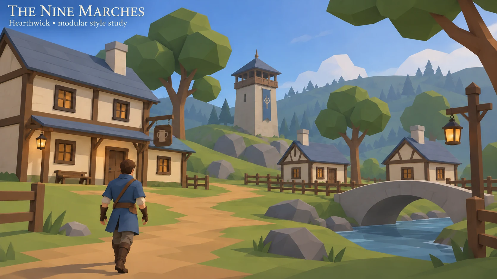
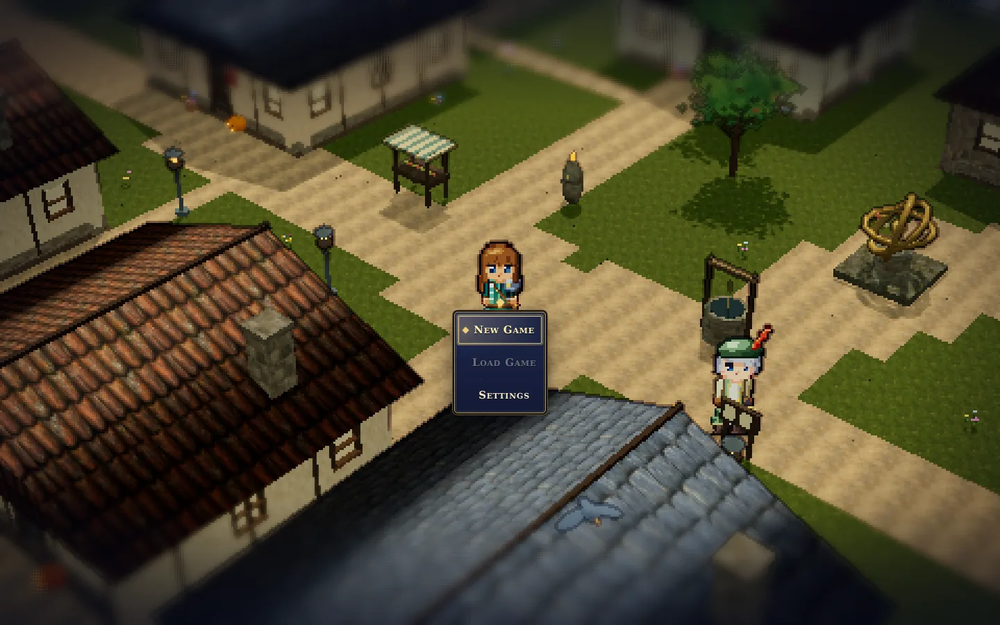
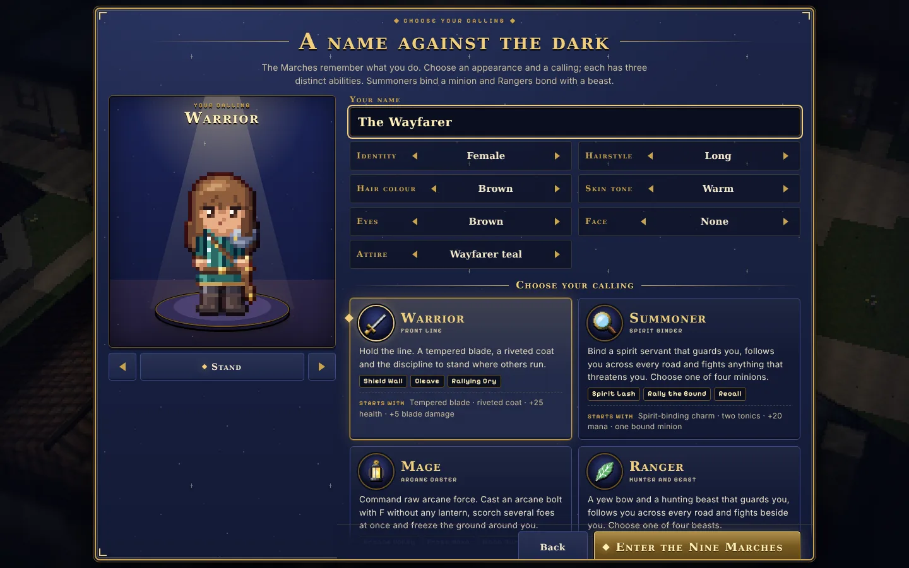
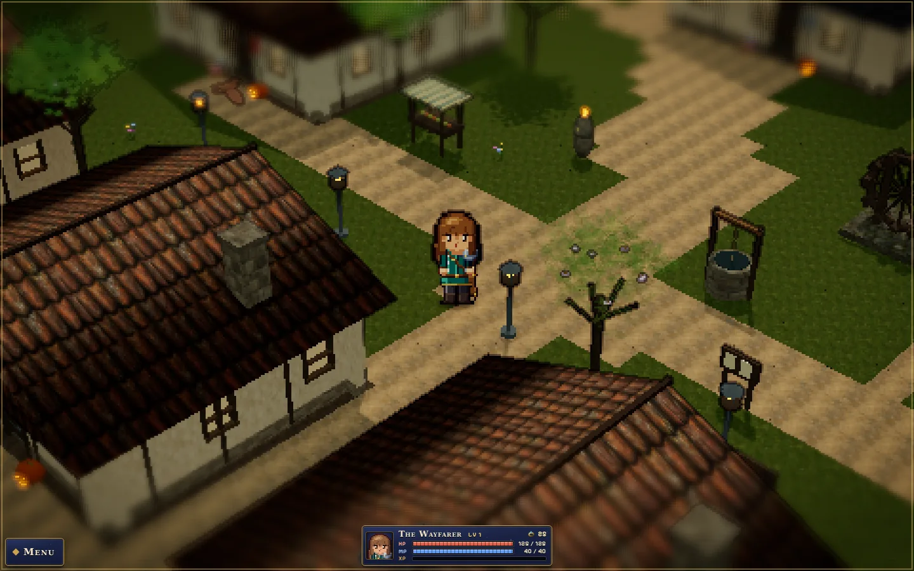
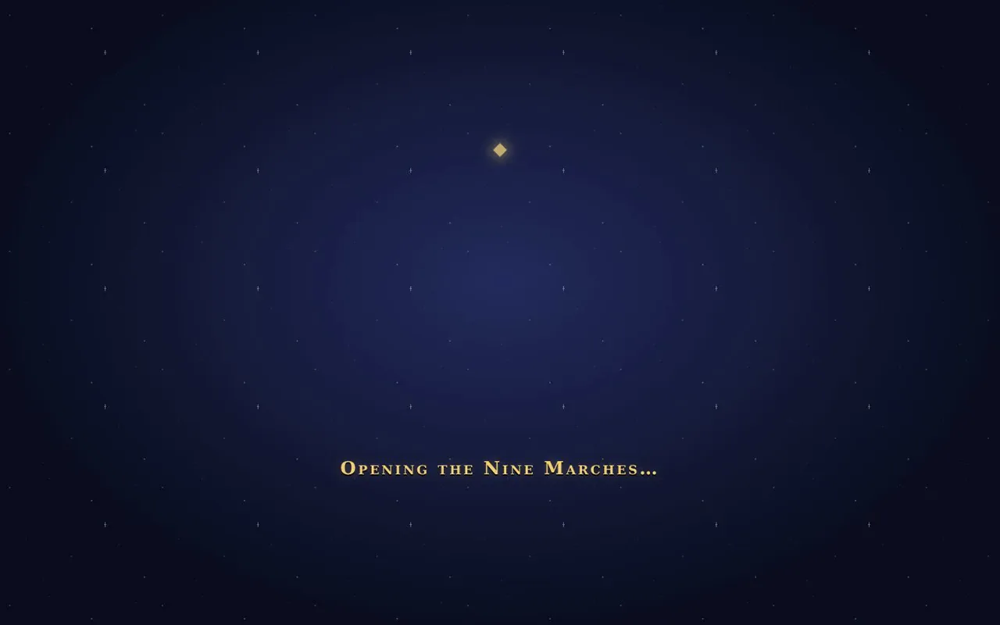

# The Nine Marches

**Explore the Nine Marches, build a life and face the horrors beyond the lanterns.**

[**▶ Live demo / Play on caseyshingledecker.com**](https://caseyshingledecker.com/demos/top-secret/lantern-gate/) · [**Source**](https://github.com/Beebopcat/lantern-gate)

[](https://caseyshingledecker.com/demos/top-secret/lantern-gate/)

*Promotional cover art; gameplay screenshots appear below.*

## What it is

*The Nine Marches* is Casey Shingledecker's browser open-world RPG in a hand-made "storybook HD-2D" style: pixel-art characters in a miniature diorama world, turn-based battles and a chaptered quest log. You begin in Hearthwick on The River March. (This repository is named `lantern-gate`, the game's original working name.)

## Screenshots

| | |
|:--:|:--:|
|  |  |
| <sub>Pixel-art village street in warm light with the title menu showing New Game, Load Game and Settings.</sub> | <sub>Character creation screen titled A Name Against the Dark, with a Warrior preview, name field and calling options.</sub> |
|  |  |
| <sub>Character creation screen with the Warrior calling highlighted and the Enter the Nine Marches button at the bottom.</sub> | <sub>Gameplay in the pixel-art village with the player character and a status bar showing health and mana.</sub> |

### Video

[](docs/media/clip.mp4)

*Click the poster to open the short screen recording (docs/media/clip.mp4).*

## How to play

1. Choose New Game or Load Game. Settings are available from the title menu.
2. On the character creation screen, enter a name and choose a calling (the screenshots show the Warrior), then press Enter the Nine Marches.
3. Move with the arrow keys or WASD, or click the ground to walk. Click a person or object to approach it.
4. Press E to interact, Space to strike and F for your lantern. Right-drag to orbit the camera and use the mouse wheel to zoom.
5. Open your inventory, quest log, map and menu (see the controls below).
6. Saves stay in this browser. If you are defeated you return to a shrine ("The shrine remembers").

**Controls**

| Key | Action |
|---|---|
| Arrow keys / WASD | Move (or click the ground to walk) |
| E | Interact |
| Space | Strike |
| F | Lantern |
| Right-drag / wheel | Orbit / zoom |
| I | Inventory |
| J | Quest log |
| M | Map |
| Esc | Menu |

### Quick start


<sub>Gameplay in the pixel-art village with the player character and a status bar showing health and mana.</sub>

## Features

- A 3D world with time, weather and season (the game starts at 08:00 on Day 1, Clear)
- Character growth: level, health (100 to start), a 40-point resource bar, XP and gold (25 to start)
- Journey Book, quest log, inventory, achievements, abilities and a skill tree
- Chaptered quest log and turn-based battles, with combat that uses your lantern, against creatures such as The Bellwrought, Drowned Sexton, Hollow Cantor, Tallow Widow and The Pale Guest
- A wardrobe system with original 3D prototype outfits
- Original orchestral music

## The story behind it

The Nine Marches shares its setting with the illustrated book Stolen Names, "a tale of the Nine Marches". The creature and outfit images are concept and model studies, not final production art. Dark fantasy with horror themes.

## Built with

- HTML and JavaScript (rpg.js and ES modules)
- A 3D renderer in the browser (three.js)
- Web Audio, with orchestral MP3 tracks and a soundfont
- Browser localStorage for saves
- Node and Playwright test suites (`qa/`)

## Repository layout

- `game/`: the playable source. Static files with no build step: serve the folder and open `index.html`.
- `qa/`: Node and Playwright test suites.
- `worktrees/`: unfinished work streams (U = menu skin, B = battle screen); S and Q are already merged.
- `tools/`: art generators. `release/`: release helper scripts.
- `docs/`: hand-off, checkpoint, design brief, and the prompt for starting a Claude cloud session.
- Project rules for Claude are in `CLAUDE.md`.

## Run it locally

```bash
git clone https://github.com/Beebopcat/lantern-gate.git
cd lantern-gate/game
python -m http.server 8000
```

Then open http://localhost:8000 in your browser.

## Content notes

Dark fantasy with horror themes.

## Credits & disclaimers

The creature and outfit images are concept and model studies, not final production art. Built by Casey Shingledecker with AI-assisted development.

## More projects

- Portfolio and live demos: https://caseyshingledecker.com/
- All repositories: https://github.com/Beebopcat

## License

Copyright (c) 2026 Casey Shingledecker. All rights reserved. Source-available for viewing and for personal, non-commercial running only; this is not open source. See [LICENSE](LICENSE). Other people's material keeps its own license; see [THIRD-PARTY-NOTICES.md](THIRD-PARTY-NOTICES.md).
